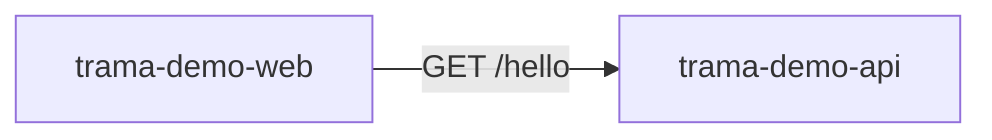

# Dependency graph

<!-- Generated by trama graph from catalog/. Do not edit by hand. -->

## Relations

| Consumer | Provider | Kind | ID | Via |
|---|---|---|---|---|
| trama-demo-web | trama-demo-api | http | GET /hello | env |
